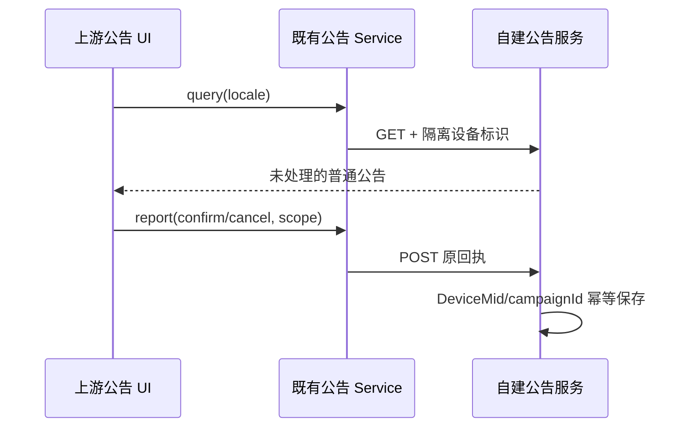

# 自建普通公告

沿用上游 Marketing Touch 的横幅、弹窗、轮询、资源与交互，使用当前自建 endpoint 的 GET /api/v1/marketing/touch 与 POST /api/v1/marketing/touch/action。公告 DeviceMid 使用现有隔离资料入口，独立 Web 与 Desktop 均可解析，不启用遥测。

允许 close、open_url、copy_text、普通 settings/plugin_marketplace 导航；禁止 claim_zcode_plan、upgrade、rewards 与定位官方账号 Provider。服务层过滤不允许的公告，UI 的共同动作入口再次验证，交互资源包不能绕过。保留上游坏投放隔离、过期 scope、资源释放和失败恢复；仅在产品边界拒绝商业动作。

服务器是处理记录唯一所有者；同 DeviceMid/campaignId 的 confirm/cancel 幂等持久化，处理后不再下发，重新发布使用新 ID。

验收涵盖中英文、横幅/弹窗、正常导航、商业动作和 bundle 动作拒绝、独立 Web 设备标识、网络失败、重复回执、重启持久化和新 ID 展示；增加客户端 E2E 场景并执行现有可用入口。
